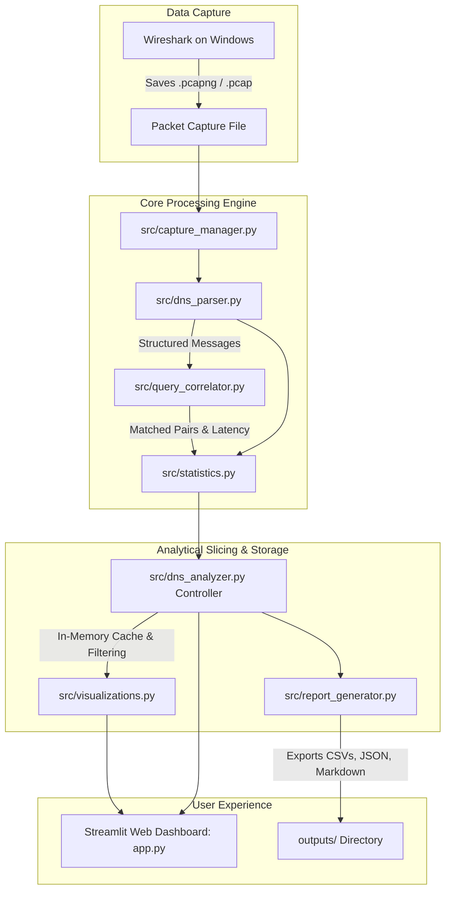

# DNS Traffic Analysis Using Wireshark
### Packet-Level Inspection, Statistical Analysis, and Visualization of DNS Traffic

[](https://www.python.org/)
[](LICENSE)
[](https://streamlit.io/)
[](https://scapy.net/)
[]()

A comprehensive, production-grade Computer Networks project designed to analyze real Domain Name System (DNS) packet captures generated by Wireshark (`.pcapng` and `.pcap`). Built in Python with a high-contrast dark theme Streamlit dashboard, this application dissects packet headers, correlates queries and responses using 5-tuple addressing, measures response latency in milliseconds, evaluates record types and response codes, and exports statistical reports.

---

## 📌 Table of Contents
1. [Project Overview](#project-overview)
2. [Problem Statement & Objectives](#problem-statement--objectives)
3. [Key Features](#key-features)
4. [System Architecture](#system-architecture)
5. [Technology Stack](#technology-stack)
6. [Project Structure](#project-structure)
7. [Installation & Windows Setup](#installation--windows-setup)
8. [Wireshark Capture Guide](#wireshark-capture-guide)
9. [Running the Application](#running-the-application)
10. [Running Automated Tests](#running-automated-tests)
11. [Data Export Formats](#data-export-formats)
12. [Sample Interface Preview](#sample-interface-preview)
13. [Limitations & Privacy](#limitations--privacy)
14. [Future Enhancements](#future-enhancements)

---

## 📖 Project Overview
The Domain Name System (DNS) is the fundamental directory service of the Internet, translating human-friendly hostnames (e.g. `example.com`) into routable IP addresses (IPv4/IPv6). While Wireshark is an exceptional packet sniffer, performing aggregate statistical analysis, response time correlation, and domain frequency breakdowns requires custom data pipelines.

This system provides:
- Automated extraction of RFC 1035 packet structures across UDP and TCP.
- A dedicated 5-tuple query-response correlation engine calculating latency ($T_{\text{response}} - T_{\text{query}}$) in milliseconds.
- Accurate domain frequency calculations strictly isolated from response packets.
- Separation of requested query types (A, AAAA, MX, CNAME, TXT) from actual returned answer record types.
- A dark-mode Streamlit dashboard with responsive filters, metric cards, and publication-ready Matplotlib visualizations.
- Comprehensive CSV, JSON, and academic Markdown export generators.

---

## 🎯 Problem Statement & Objectives

### Problem Statement
Analyzing raw packet captures containing thousands of interleaved frames is tedious and prone to analytical errors. Evaluators and students frequently struggle to correlate responses with requests, misidentify unanswered queries as system failures, or fail to account for DNS caching and transaction ID reuse.

### Objectives
- Dissect DNS packets without relying on external cloud APIs or paid infrastructure.
- Accurately pair queries with responses using socket 5-tuples and transaction IDs.
- Quantify network latency percentiles (Mean, Median, 95th Percentile, Min, Max).
- Classify DNS response codes (NOERROR, NXDOMAIN, SERVFAIL, REFUSED).
- Deliver a complete, defensible project suitable for university evaluation.

---

## ✨ Key Features
- **Capture Ingestion:** Reads `.pcapng`, `.pcap`, and `.cap` capture files directly via Scapy.
- **Header Field Dissection:** Extracts Transaction ID, QR, OpCode, AA, TC, RD, RA, RCODE, Question Records, and Answer Records.
- **5-Tuple Causality Matching:** Reverses Client/Server IPs and Ports with strict causality ($T_{\text{resp}} \ge T_{\text{query}}$) to eliminate false matches.
- **Latency Percentiles:** Computes exact round-trip response latency in milliseconds with histogram visualization.
- **Interactive Dashboard:**
  - Executive KPI cards.
  - Searchable and paginated DNS Message Explorer.
  - Six dark-themed statistical charts with descriptive captions.
  - Deep packet field inspector showing raw flags and answers.
  - In-app academic report reader and threshold-based slow lookup highlighter.
- **Multi-Format Exports:** One-click generation of 7 structured CSV files, JSON summary, and full Markdown report.

---

## 🏗️ System Architecture



---

## 🛠️ Technology Stack
- **Language:** Python 3.11 / 3.12 (standard 64-bit Windows installation)
- **Capture Ingestion & Parsing:** Scapy (`scapy>=2.5.0`)
- **Data Analysis & Structures:** Pandas (`pandas>=2.2.0`), NumPy
- **Visual Analytics:** Matplotlib (`matplotlib>=3.8.0`)
- **Interactive UI Dashboard:** Streamlit (`streamlit>=1.35.0`)
- **Automated Testing:** Pytest (`pytest>=8.0.0`)
- **Packet Sniffer:** Wireshark & Tshark (Windows)

---

## 📁 Project Structure

```
DNS-Traffic-Analysis/
│
├── app.py                         # Streamlit interactive web dashboard
├── README.md                      # Comprehensive project documentation
├── requirements.txt               # Locked project dependencies
├── .gitignore                     # Git ignore rules (prevents committing PCAPs & caches)
├── .streamlit/
│   └── config.toml                # Dark theme configuration (Navy/Cyan/Slate)
│
├── src/
│   ├── __init__.py                # Package initialization
│   ├── capture_manager.py         # PCAP/PCAPNG file loader and reader
│   ├── dns_parser.py              # Packet header dissector and record extractor
│   ├── dns_analyzer.py            # Analysis orchestrator and filter controller
│   ├── query_correlator.py        # 5-tuple query-response correlation engine
│   ├── statistics.py              # Latency, domain frequency, and RCODE statistics
│   ├── visualizations.py          # Publication-ready Matplotlib chart generators
│   ├── report_generator.py        # CSV, JSON, and Markdown report exporter
│   └── utils.py                   # Domain normalization and DNS lookup tables
│
├── scripts/
│   ├── generate_test_capture.py   # Synthetic test capture builder for test suites
│   └── validate_capture.py        # Command-line capture validation utility
│
├── tests/
│   ├── test_dns_parser.py         # Packet parsing and flag extraction tests
│   ├── test_query_correlator.py   # Latency and 5-tuple correlation tests
│   ├── test_statistics.py         # Frequency and distribution tests
│   └── test_capture_loading.py    # Ingestion, error-handling, and export tests
│
├── captures/
│   └── .gitkeep                   # Local directory for PCAP/PCAPNG capture files
│
├── outputs/
│   └── .gitkeep                   # Destination folder for generated CSVs & reports
│
├── screenshots/
│   └── .gitkeep                   # Destination folder for dashboard screenshots
│
└── report/
    └── project_report.md          # Full academic Computer Networks project report
```

---

## 💻 Installation & Windows Setup

### Step 1: Open PowerShell
Open PowerShell as a standard user (no administrator privileges required). Navigate to your project folder:
```powershell
cd D:\Nandhu\cn_cbp
```

### Step 2: Create a Virtual Environment
```powershell
python -m venv .venv
```

### Step 3: Activate the Virtual Environment
In **PowerShell**:
```powershell
.\.venv\Scripts\Activate.ps1
```
> **PowerShell ExecutionPolicy Note:** If you encounter a script execution error in PowerShell, execute this safe, session-scoped command:
> ```powershell
> Set-ExecutionPolicy -Scope Process -ExecutionPolicy Bypass
> .\.venv\Scripts\Activate.ps1
> ```

In **Command Prompt (cmd.exe)**:
```cmd
.venv\Scripts\activate.bat
```

### Step 4: Install Dependencies
```powershell
python -m pip install -r requirements.txt
```

---

## 🦈 Wireshark Capture Guide

Follow these steps to record genuine DNS traffic from your computer:

1. **Launch Wireshark** on Windows.
2. In the interface list, double-click your active connection (**Wi-Fi** or **Ethernet**).
3. In the Wireshark display filter toolbar, type `dns` and press **Enter**.
4. Open PowerShell or Command Prompt and generate varied DNS queries using `nslookup`:
   ```powershell
   # Standard IPv4 lookups
   nslookup example.com
   nslookup wikipedia.org
   nslookup github.com

   # Explicit record type queries
   nslookup -type=A example.com
   nslookup -type=AAAA example.com
   nslookup -type=MX gmail.com
   nslookup -type=TXT google.com

   # Test non-existent domain (generates NXDOMAIN response)
   nslookup nonexistent-domain-847291.example
   ```
5. Return to Wireshark and click the red **Stop Capture** square button.
6. Click **File -> Save As...**, select `.pcapng` format, and save the file into the project's `captures/` folder (e.g., `captures/my_capture.pcapng`).
7. Open the dashboard and load your capture!

---

## 🚀 Running the Application

### 1. Generate Synthetic Test Capture (Optional)
To verify everything immediately without launching Wireshark, generate a synthetic test capture:
```powershell
python scripts/generate_test_capture.py
```
This generates `captures/synthetic_test_capture.pcap` with 20 sample packets representing varied real-world scenarios.

### 2. Validate via Terminal (CLI)
You can validate any capture directly from the command line:
```powershell
python scripts/validate_capture.py captures/synthetic_test_capture.pcap
```

### 3. Launch the Streamlit Dashboard
```powershell
streamlit run app.py
```
Streamlit will automatically open your default browser to `http://localhost:8501`.

---

## 🧪 Running Automated Tests

The project includes an automated test suite verifying all 19 RFC requirements:
```powershell
python -m pytest -v
```

### Test Coverage Highlights:
- Valid DNS queries and responses across UDP and TCP.
- A, AAAA, CNAME, MX, and TXT record dissections.
- NXDOMAIN and SERVFAIL error handling.
- Prevention of negative latency ($T_{\text{resp}} < T_{\text{query}}$).
- Millisecond-precision round-trip time calculations.
- Handling of transaction ID collisions and retransmissions.
- Isolation of query domain frequencies (preventing responses from skewing counts).
- Graceful handling of empty or corrupted captures.

---

## 📊 Data Export Formats

When you click **Export All 7 CSVs to outputs/**, the following files are produced:

| Export Filename | Description |
| :--- | :--- |
| `dns_messages.csv` | Comprehensive log of every captured DNS packet with parsed headers |
| `dns_queries.csv` | Client query messages only |
| `dns_responses.csv` | Server response messages only |
| `dns_transactions.csv` | Correlated Query-Response pairs with calculated latency in milliseconds |
| `domain_statistics.csv` | Queried domain names ranked by frequency and percentage |
| `query_type_statistics.csv` | Breakdown of requested query types (A, AAAA, MX, etc.) |
| `response_code_statistics.csv` | Proportions of response codes (NOERROR, NXDOMAIN, etc.) |
| `dns_analysis_summary.json` | Machine-readable executive summary |
| `project_report.md` | Academic Markdown report formatted for grading |

---

## 📸 Sample Interface Preview

*(Genuine screenshots will be saved into the `screenshots/` directory during evaluation demonstration)*

```
+-----------------------------------------------------------------------------------+
|  DNS Traffic Analysis                                         [ CAPTURE LOADED ] |
|  Wireshark Packet Inspection and Statistical Analysis                             |
+-----------------------------------------------------------------------------------+
|  [Total Packets]     [DNS Packets]      [DNS Queries]      [DNS Responses]        |
|       1,420              1,380               710                 670              |
|                                                                                   |
|  [Unique Domains]    [Matched Pairs]    [Mean Latency]     [NXDOMAIN Responses]   |
|        142                652              28.45 ms                 18            |
+-----------------------------------------------------------------------------------+
|  Tabs: [Overview] [Traffic Explorer] [Visual Analytics] [Packet Details] [Report] |
|                                                                                   |
|  +-------------------------------------+  +------------------------------------+  |
|  | Top 10 Queried Domains (Bar Chart)  |  | Query-Type Distribution (Bar Chart)|  |
|  | - example.com            (45)       |  | - A     : 68%                      |  |
|  | - wikipedia.org          (32)       |  | - AAAA  : 22%                      |  |
|  | - github.com             (24)       |  | - MX    : 10%                      |  |
|  +-------------------------------------+  +------------------------------------+  |
+-----------------------------------------------------------------------------------+
```

---

## ⚠️ Limitations & Privacy Considerations

- **Encrypted DNS (DoH / DoT):** Modern web browsers and operating systems increasingly utilize DNS-over-HTTPS (port 443) or DNS-over-TLS (port 853). These packets appear as encrypted TLS traffic and cannot be dissected without private SSL/TLS session secrets. Use `nslookup` for guaranteed unencrypted traffic.
- **Operating System DNS Caching:** Windows caches DNS records locally in `dnscache`. Subsequent requests within the TTL period are answered from local RAM without emitting wire packets. Use `ipconfig /flushdns` to clear local cache when testing.
- **Privacy Notice:** DNS queries expose visited domains and internal hostnames. Never share or commit raw packet captures containing sensitive personal or corporate data to public Git repositories.

---

## 🔮 Future Enhancements
- Integration with `SSLKEYLOGFILE` for decrypting and inspecting DNS-over-HTTPS (DoH).
- Shannon entropy analysis of subdomain strings to identify potential DNS tunneling or data exfiltration.
- DNSSEC chain validation engine (inspecting RRSIG, DNSKEY, and DS records).

---

## 📜 License
Developed as an academic Computer Networks mini-project under the MIT License.
