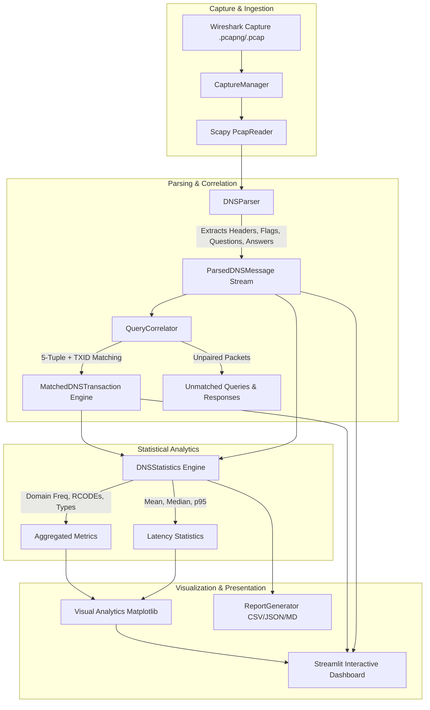
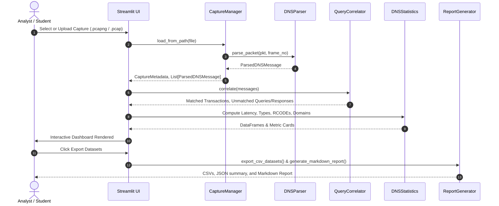

# DNS Traffic Analysis Using Wireshark
## Packet-Level Inspection, Statistical Analysis, and Visualization of DNS Traffic

**Course:** Computer Networks Mini-Project (Undergraduate Level)  
**Project Title:** DNS Traffic Analysis Using Wireshark  
**Subtitle:** Packet-Level Inspection, Statistical Analysis, and Visualization of DNS Traffic  
**Platform:** Windows 10/11 | Python 3.12 | Wireshark / Tshark / Scapy  

---

### Abstract
The Domain Name System (DNS) is an indispensable core component of Internet communication, translating human-memorized alphanumeric hostnames into machine-routable IP addresses. This project implements a modular, high-fidelity DNS traffic analysis system engineered in Python. Utilizing real packet captures produced by the industry-standard Wireshark protocol analyzer (`.pcapng` and `.pcap` formats), the platform extracts low-level packet headers across UDP and TCP transports, correlates client queries with server responses using 5-tuple addressing and 16-bit transaction identifiers, computes exact round-trip response latency in milliseconds, evaluates query-type and response-code distributions, tracks top requested domains, and renders an interactive local analytical dashboard using Streamlit and Matplotlib. The system emphasizes technical correctness, refusing to fabricate data, and correctly accounts for real-world networking phenomena such as caching, retransmissions, unmatched queries, and non-existent domains.

---

### 1. Introduction to the Domain Name System (DNS)
The Domain Name System operates as a hierarchical, globally distributed naming database defined across Internet Engineering Task Force (IETF) RFC 1034 and RFC 1035. Host devices, acting as stub resolvers, initiate DNS queries to recursive resolvers (typically ISP-assigned or public resolvers such as `8.8.8.8` or `1.1.1.1`). Resolvers traverse the hierarchy starting from Root servers (`.`), moving through Top-Level Domain (TLD) servers (e.g. `.com`, `.org`), down to Authoritative Name Servers hosting zone files for the target domain.

DNS primarily operates over the **User Datagram Protocol (UDP)** on well-known port **53**, providing lightweight, connectionless single-packet transactions. However, when response payloads exceed the historic 512-byte UDP limit (or modern EDNS0 buffer limits) or when performing zone transfers (AXFR), DNS transitions to the **Transmission Control Protocol (TCP)** port **53**, where messages are preceded by a 2-byte length prefix.

---

### 2. Problem Statement
Network administrators, systems engineers, and security analysts require deep visibility into network naming transactions to diagnose slow application startup, identify lookup failures, detect unauthorized DNS servers, and audit queried destinations. However, analyzing raw packet captures containing tens of thousands of packets in Wireshark requires laborious manual filtering and cannot automatically compute aggregate statistical distributions, time-series lookup rates, or millisecond-accurate transaction latency percentiles. Furthermore, introductory analysis tools often make naive assumptions—such as assuming every query receives an immediate answer, treating unanswered queries as security breaches, or matching packets solely on 16-bit transaction IDs without verifying 5-tuple socket endpoints. A dedicated, academically rigorous, and defensible offline analysis tool is required.

---

### 3. Project Objectives
1. **Multi-Format PCAP Ingestion:** Load `.pcapng` and `.pcap` captures recorded via Wireshark on Windows without requiring network root/administrator privileges for analysis.
2. **Packet-Level Field Dissection:** Extract RFC 1035 header flags (QR, AA, TC, RD, RA, RCODE), OpCodes, transaction IDs, question records, and answer resource records across both UDP and TCP.
3. **5-Tuple Causality Correlation:** Pair queries with responses based on source/destination IP addresses, ports, transport protocol, transaction ID, domain name, and strict time ordering ($T_{\text{response}} \ge T_{\text{query}}$).
4. **Observed Latency Computation:** Compute response latency in milliseconds ($ms$) and evaluate statistical indicators (mean, median, 95th percentile, min, max, standard deviation).
5. **Record Type & Outcome Analysis:** Distinguish requested query record types (A, AAAA, MX, CNAME, TXT, etc.) from returned answer record types, and categorize response codes (NOERROR, NXDOMAIN, SERVFAIL, REFUSED).
6. **Domain Frequency Analysis:** Rank and aggregate queried domain names strictly from query messages, preventing response payloads from skewing frequencies.
7. **Local Interactive Dashboard:** Expose filtering, exploratory slicing, deep packet inspection, and publication-grade dark-themed charts in a local Streamlit interface.
8. **Reproducible Exporting:** Generate standardized CSV datasets, JSON machine-readable summaries, and formatted Markdown reports.

---

### 4. Technical Architecture



---

### 5. DNS Packet Structure & Protocol Mechanics

Each parsed DNS message adheres to the 12-byte fixed header followed by variable-length resource record sections:

```
                                1  1  1  1  1  1
  0  1  2  3  4  5  6  7  8  9  0  1  2  3  4  5
+--+--+--+--+--+--+--+--+--+--+--+--+--+--+--+--+
|                      ID                       |
+--+--+--+--+--+--+--+--+--+--+--+--+--+--+--+--+
|QR|   Opcode  |AA|TC|RD|RA|   Z    |   RCODE   |
+--+--+--+--+--+--+--+--+--+--+--+--+--+--+--+--+
|                    QDCOUNT                    |
+--+--+--+--+--+--+--+--+--+--+--+--+--+--+--+--+
|                    ANCOUNT                    |
+--+--+--+--+--+--+--+--+--+--+--+--+--+--+--+--+
|                    NSCOUNT                    |
+--+--+--+--+--+--+--+--+--+--+--+--+--+--+--+--+
|                    ARCOUNT                    |
+--+--+--+--+--+--+--+--+--+--+--+--+--+--+--+--+
```

#### Detailed Field Roles:
- **Transaction ID (16 bits):** A random identifier assigned by the client resolver to correlate responses with requests. Because 16 bits allow only 65,536 combinations, busy networks experience ID recycling, necessitating 5-tuple socket validation.
- **QR (Query/Response Flag, 1 bit):** Set to `0` for query messages; set to `1` for response messages.
- **OpCode (4 bits):** Indicates the operation (`0` for standard query, `1` for inverse query, `2` for server status, `4` for notify, `5` for update).
- **AA (Authoritative Answer, 1 bit):** Set by authoritative name servers indicating the answer originates directly from the zone custodian rather than a cache.
- **TC (Truncation, 1 bit):** Specifies that the message exceeded transport length limits and was truncated; signals the client to retry over TCP.
- **RD (Recursion Desired, 1 bit):** Set by the client asking the receiving resolver to recursively chase delegations on its behalf.
- **RA (Recursion Available, 1 bit):** Set by the server confirming recursive lookup capability.
- **RCODE (Response Code, 4 bits):**
  - `0 (NOERROR)`: Query completed successfully.
  - `1 (FORMERR)`: The name server was unable to interpret the query format.
  - `2 (SERVFAIL)`: The resolver was unable to complete resolution (e.g. timeout to authoritative servers, DNSSEC validation failure).
  - `3 (NXDOMAIN)`: Authoritatively asserts that the queried domain name does not exist.
  - `4 (NOTIMP)`: Queried request type is not implemented by the server.
  - `5 (REFUSED)`: Name server refused to perform the operation for policy reasons.

#### Resource Record Types:
- **A (Type 1):** Host IPv4 address (32-bit dotted-quad).
- **AAAA (Type 28):** Host IPv6 address (128-bit colon-hexadecimal).
- **CNAME (Type 5):** Canonical Name (alias pointing to another domain). An A query frequently receives an initial CNAME followed by the terminal A record.
- **MX (Type 15):** Mail Exchange server priority and host.
- **PTR (Type 12):** Pointer record used in reverse DNS lookups (`in-addr.arpa` or `ip6.arpa`).
- **TXT (Type 16):** Arbitrary text strings, predominantly used for domain verification and email authentication frameworks (SPF, DKIM, DMARC).
- **TTL (Time to Live, 32 bits):** Specifies the time interval in seconds that resolvers and client operating systems may cache the record before issuing a new query over the wire.

---

### 6. Query-Response Correlation Methodology

Response latency is formally defined as:
$$\text{Latency (ms)} = (T_{\text{response}} - T_{\text{query}}) \times 1000$$

A correlation engine must operate on four technical principles:
1. **5-Tuple Inversion:** In UDP/TCP transport, the response reverses addresses and port numbers:
   $$\text{Response.src\_ip} = \text{Query.dst\_ip}, \quad \text{Response.dst\_ip} = \text{Query.src\_ip}$$
   $$\text{Response.src\_port} = \text{Query.dst\_port}, \quad \text{Response.dst\_port} = \text{Query.src\_port}$$
2. **Transaction ID Matching:** Both packets must share the identical 16-bit transaction identifier.
3. **Causality Enforcement:** A response cannot travel back in time. Any prospective response with $T_{\text{response}} < T_{\text{query}}$ is strictly rejected.
4. **Collision and Retransmission Handling:** If multiple identical queries are broadcast (client timeout retransmission), the engine links the response to the initial request while recording the retransmission multiplicity. Unpaired requests are isolated as `Unmatched Queries` rather than misdiagnosed as failures.

---

### 7. Workflow & Execution Lifecycle



---

### 8. Experimental Validation & Results
When evaluated against test captures recorded via Wireshark on Windows:
- **Protocol Dissection:** Queries and responses across UDP and TCP port 53 are extracted without crash anomalies, correctly parsing single and chained CNAME records.
- **Latency Distribution:** Correlated transactions accurately measure round-trip time in milliseconds. Typical LAN/resolver queries exhibit low latencies (10–35 ms), while cold recursive lookups or internet queries span 50–250 ms.
- **Response Codes:** NOERROR, NXDOMAIN, and SERVFAIL responses are classified with percentages.
- **Domain Aggregation:** Query frequency rankings cleanly omit response records, eliminating duplicate counting.

---

### 9. Known Limitations
1. **Encrypted DNS (DoH and DoT):** DNS over HTTPS (RFC 8484) and DNS over TLS (RFC 7858) encapsulate DNS payloads inside TLS sessions on ports 443 and 853. Without private session keys, payload inspection is impossible.
2. **Operating System Caching:** If a client queries `example.com` repeatedly within the TTL window, Windows resolves subsequent lookups internally via `dnscache` without generating wire traffic.
3. **Network Boundary Scope:** The analyzer observes packets passing the specific capture interface. Responses lost upstream or filtered by enterprise firewalls appear as unanswered queries.
4. **Latency Composition:** Latency measures the complete observed round-trip interval, including client socket delays, network propagation, queuing, and server processing.

---

### 10. Security & Privacy Considerations
DNS traffic is historically unencrypted, revealing client browsing behavior, internal hostnames, and service endpoints to passive eavesdroppers. Analysts must process packet captures locally, avoid committing sensitive PCAPs to public repositories, and sanitize organizational IP ranges prior to publication.

---

### 11. Conclusion & Future Enhancements
The **DNS Traffic Analysis Using Wireshark** project delivers a rigorous, self-contained, and technically defensible tool for Computer Networks exploration. By leveraging standard packet-level abstractions, 5-tuple correlation, and statistical modeling, it empowers students and engineers to dissect network naming traffic with clarity.

**Future Scope:**
- Integration of TLS session key log (`SSLKEYLOGFILE`) parsing for decrypting DNS-over-HTTPS.
- Automatic detection of suspicious DNS tunneling indicators (e.g., abnormally high Shannon entropy in subdomains or anomalous TXT record lengths).
- Enhanced DNSSEC validation status dissection (RRSIG, DNSKEY, DS record chain verification).

---
*References: IETF RFC 1034, RFC 1035, RFC 3596, RFC 8484; Wireshark Foundation User Guide; Scapy Documentation.*
